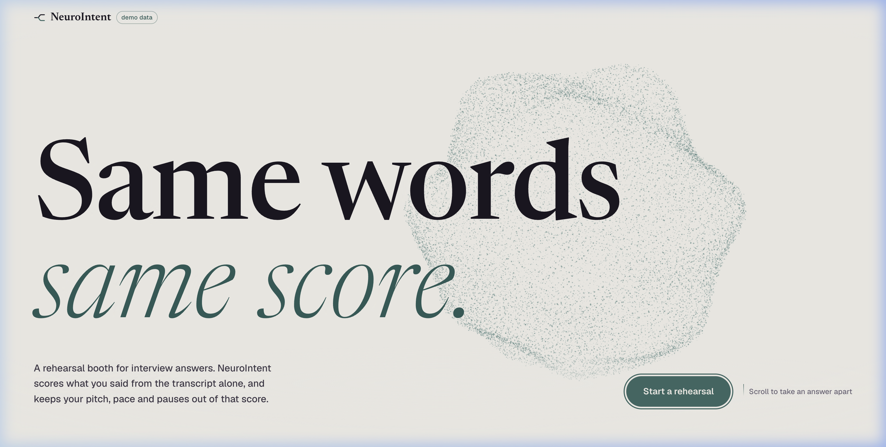
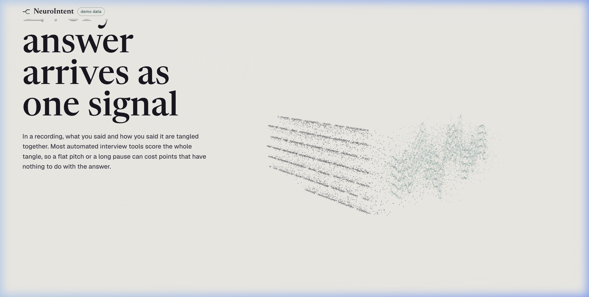
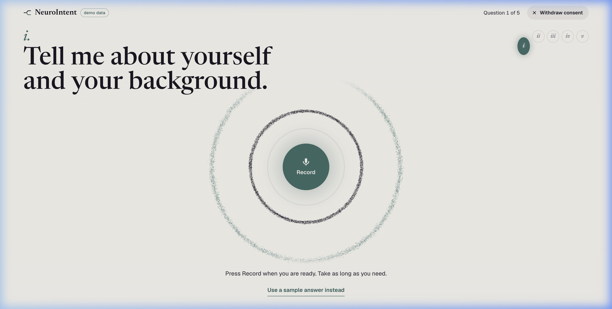
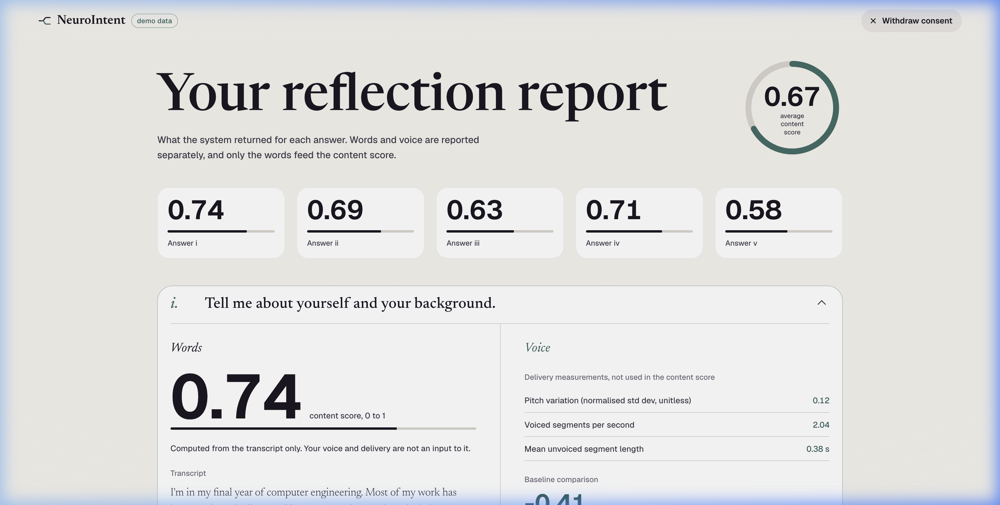

# NeuroIntent

<div align="center">

**Scores what you say, not how it sounds.**

*Communication-style-invariant interview rehearsal and intent interpretation for neurodivergent candidates in automated hiring pipelines.*

[](https://dev-coder21.github.io/NeuroIntent/)
[](src/frontend/rehearsal)
[](src/api)
[](PROJECT_STATUS.md)

[**Explore Live Booth Demo**](https://dev-coder21.github.io/NeuroIntent/) · [**Watch Walkthrough Video**](media/NeuroIntent-demo.mp4) · [**Architecture Spec**](Architecture%20Specification.md)

</div>

---

## 🌟 Interface & Visual Showcase

The newly redesigned **NeuroIntent Rehearsal Booth** features a calm porcelain and muted-teal visual identity (`#F3F1EC` ground, `#3E6B66` teal, `#1B1722` ink), dynamic WebGL particle stage physics, editorial typography (*Geist* & *Newsreader*), and scroll-scrubbed interactive chapters.

### 1. Rehearsal Booth Hero
> An ambient WebGL particle field represents spoken language dynamics: words (ink particles) and vocal delivery (teal particles).

<div align="center">
  
</div>

<br />

### 2. Interactive Concept Chapters
The interactive story explains how the machine decouples speech into content and acoustics:

| Chapter I: The Split | Chapter II: Flatten the Voice |
| :---: | :---: |
| Whisper transcribes *what* is said, while openSMILE measures *how* it sounded. | An interactive delivery dial demonstrates how content score remains rock-solid while prosody is flattened. |
|  |  |

<br />

### 3. Interview Rehearsal, Analysis & Reflection

Candidates rehearse responses to standard interview questions inside the booth, receive transparent real-time feedback, and explore an explainability report:

| Recording in the Booth | Real-Time Dual-Track Analysis | Candidate Reflection Report |
| :---: | :---: | :---: |
| Responsive microphone ring reacts to live vocal pitch & amplitude. | Sequential scoring pipeline processes text through RoBERTa and voice via GeMAPS. | Final report with aggregate score ring, delivery metrics, and contrast baseline. |
|  |  |  |

---

## 🎯 The Problem

Automated hiring tools (video interview evaluators, asynchronous screening bots, and AI resume/response scorers) are calibrated on neurotypical communication norms. Research demonstrates that these algorithms heavily weight prosodic delivery:
- Pitch variation and inflection
- Speaking rate and rhythm
- Processing pauses and hesitations

For candidates with **Autism Spectrum Disorder (ASD)**, prosody naturally diverges from neurotypical baselines due to neurological differences, not competency gaps. When an ASD speaker delivers an answer with a flat pitch, extended processing pauses, or direct phrasing, conventional systems unfairly lower their score.

> **NeuroIntent does not attempt to train neurodivergent candidates to "mask" or emulate neurotypical speech. It corrects the measurement instrument.**

---

## 🔬 How NeuroIntent Works

```
                        Raw Spoken Answer
                               │
               ┌───────────────┴───────────────┐
               ▼                               ▼
       Layer 1: Speech                Layer 1: Prosodic
        Transcription                     Extraction
     (Whisper Large-v3)              (openSMILE GeMAPS 62)
               │                               │
               ▼                               ▼
        Text Transcript                Acoustic Features
               │                               │
               ▼                               ▼
       Layer 2: Content                Layer 2: Prosody
       Quality Scorer                 Baseline Comparison
      (RoBERTa-large)               (Statistical Alignment)
               │                               │
               └───────────────┬───────────────┘
                               │
          Orthogonal Representation Constraint
                 (Decoupling Objective)
                               │
                               ▼
        Layer 3: Candidate Reflection Dashboard
           • Content Quality Score (0–100%)
           • Separated Delivery Measurements
           • Feature Attribution & Audit Trail
```

1. **Answer out loud**: 5 standard behavioral and technical questions recorded directly in-browser.
2. **Text transcription**: Whisper transcribes the exact spoken content.
3. **Decoupled scoring**:
   - **Content ($C$)**: RoBERTa processes the transcript text alone; audio features are completely excluded from the content score.
   - **Delivery ($D$)**: openSMILE extracts 62 GeMAPS acoustic features (pitch std dev, jitter, voiced/unvoiced duration, loudness).
   - **Orthogonality**: Representations $C$ and $D$ are constrained to be statistically independent.
4. **Transparent Reflection Report**: Both dimensions are presented side by side so speakers understand their content strengths without being penalized for delivery style.

---

## 🛡️ Ground Rules & Ethical Safeguards

- 🚫 **No Diagnostic Claims**: NeuroIntent does **not** detect, screen for, or diagnose autism or any medical condition.
- 🚫 **No Masking Coaching**: It never suggests candidates should change their natural voice, smile more, or speak faster.
- 🔒 **Zero Data Retention**: Audio and transcripts are processed ephemerally in memory and discarded immediately upon completion.
- 🔍 **Strict Explainability**: Every score includes transparent attribution markers; the system never invents or hallucinates metrics.

---

## 💻 Tech Stack

| Layer | Technologies | Responsibility |
|---|---|---|
| **Frontend** | React 19, Vite, Tailwind CSS, Raw WebGL | Rehearsal booth, audio capture, dynamic particle physics |
| **ASR** | OpenAI Whisper | Ephemeral speech-to-text transcription |
| **NLP** | RoBERTa-large, Hugging Face Transformers | Text content representation & quality scoring |
| **Acoustics** | openSMILE (GeMAPSv01b - 62 features) | Voice prosody, pitch variation, pause analytics |
| **Backend** | FastAPI, Pydantic, Python 3.11, Uvicorn | High-throughput inference API |
| **Hosting** | GitHub Pages (CI/CD via GitHub Actions) | Automated continuous deployment |

---

## 🚀 Quickstart & Local Setup

### 1. Run the Rehearsal Frontend

```bash
# Clone the repository
git clone https://github.com/Dev-coder21/NeuroIntent.git
cd NeuroIntent

# Install frontend dependencies
cd src/frontend/rehearsal
npm install

# Start local development server
npm run dev
```

Open `http://localhost:5173/` in your browser.

> **Tip**: Visit `http://localhost:5173/?demo` to test the booth in standalone demo mode with curated sample answers and instant simulated analysis without launching the backend.

### 2. Run the Analysis Backend

```bash
cd src/api

# Create and activate virtual environment
python3 -m venv .venv
source .venv/bin/activate

# Install requirements
pip install -r requirements.txt

# Start the API server
uvicorn main:app --reload --port 8000
```

Backend health check is available at `http://localhost:8000/health`.

---

## 🌐 GitHub Pages Deployment

The frontend automatically builds and deploys to GitHub Pages on every push to `main` via the GitHub Actions workflow at [`.github/workflows/deploy.yml`](.github/workflows/deploy.yml).

- **Live URL**: [https://dev-coder21.github.io/NeuroIntent/](https://dev-coder21.github.io/NeuroIntent/)

---

## 👥 Project Team

- **Dev Trivedi** ([@Dev-coder21](https://github.com/Dev-coder21)) — Product Lead & Frontend Engineering, Rehearsal Booth UI/UX, WebGL stage, and data pipelines.
- **Deval Shah** ([@devalshah-04](https://github.com/devalshah-04)) — AI Architecture Lead, model design, decoupling loss formulation, and evaluation.
- **Krishiv** — Systems & Infrastructure Lead, backend API serving, and deployment.

---

## 📄 License

This project is licensed under the [MIT License](package.json).
